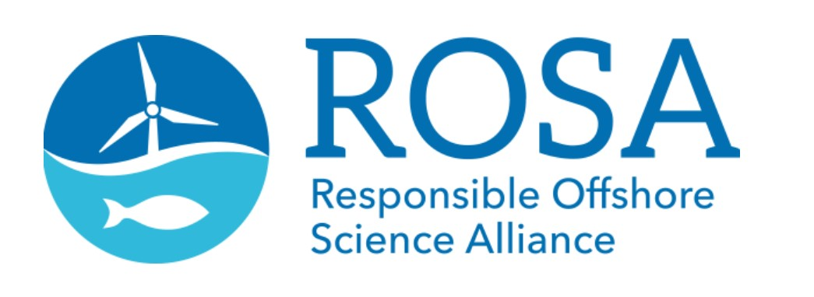
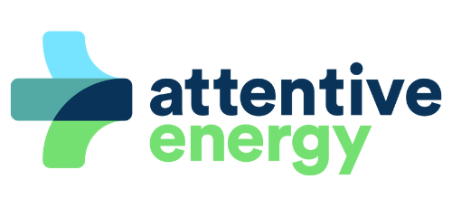
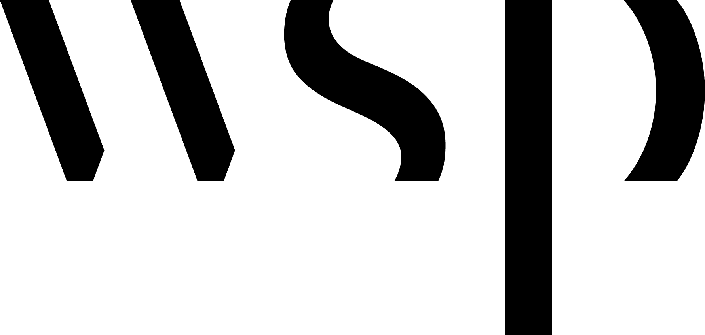

```{r echo=FALSE, message=FALSE, msg = F, warning = F, error = F}
library(gauntlet)
library(magrittr)
library(targets)
library(tidyverse, quietly = TRUE)

package_load_q = purrr::quietly(gauntlet::package_load)

tmp = c("tibble", "tidyverse", "magrittr","gauntlet"
        ,"gauntletReactable", "reactable", "reactablefmtr"
        ,"crosstalk", "plotly"
        ,"bslib","bsicons", "htmltools", "shiny") %>% 
  package_load_q()
```

```{r}
# setwd(here::here())
table_height = 500

# source(here::here("code/helpers_skankey.R"))
```

```{css}
.navbar {
background-color: #016FB1;
}

.cardSpecBig {
text-align: center;
font-size: large;
}

.cardcenter {
text-align: center;
}

.cardSpecSmall {
text-align: center;
font-size: small;
}
```

```{r}
#note: tar_load can only be called when knitting via targets
#----- calling targets via tar_load links rpt_tar_object to items 
# setwd(here::here())
# tar_load_everything()

#note: tar_load can only be called when knitting via targets
#----- calling targets via tar_load links rpt_tar_object to items 
tar_load(data_current_pro)
tar_load(data_current_srn)
tar_load(data_needed_pro)
tar_load(data_srn_pro)
tar_load(viz_prj_timeline)
tar_load(viz_proj_location_tree)
tar_load(viz_tble_crrnt_proj_shrt)
tar_load(viz_tble_dcntr_acc)
tar_load(viz_tble_dcntr_current)
tar_load(viz_tble_dcntr_def)
tar_load(viz_tble_dcntr_need)
tar_load(viz_tble_dcntr_ref)
tar_load(viz_tble_dcntr_srn)

tar_source()
# source("R/mk_tble_crrnt_srn_xwalk.R")
# source("R/mk_special_header.R")
# source("R/mk_tble_smmry_srn.R")

```

# Welcome Page

## Row {height = "15%"}

::: cardSpecBig
Welcome to the <strong>FishFORWRD Database</strong>\
Developed in Partnership by <strong>ROSA</strong>, <strong>Attentive Energy</strong>, and <strong>WSP</strong>\
{width="10%"} {width="10%"} {width="5%"}
:::

## Row {height="70%"}

### Column {width="60%"}

```{r}
#| expandable: TRUE
bslib::card(
  bslib::card_body(
    shiny::markdown("
<strong>FishFORWRD | Fish and Fisheries OffshoRe Wind Database</strong><br>
- FishFORWRD is a catalog of all East Coast <strong>research</strong>, <strong>monitoring efforts</strong>, and stated <strong>research needs</strong> for offshore wind, fish, and fisheries.   
- Included are research and monitoring funded specifically to understand offshore wind potential effects on fish and fisheries.   
- The <strong>objective</strong> of FishFORWRD is to increase awareness of ongoing work, avoid duplication of efforts, and create a common understanding of research needs. This tool is meant for research funders, fisheries and offshore wind researchers, offshore wind developers, and the public.   


<strong>How to use this Dashboard</strong><br>
- <strong>Filter</strong> projects and research needs by location, research category, methodology used, funder and more. 
- <strong>Download</strong> database information to explore information outside of the webtool
- <strong>Submit</strong> new projects, new needs, and corrections

<strong>Explanation of Tabs</strong>

<strong>[Research Overview:](#research-overview)</strong> View completed and ongoing projects with high level attributes. This includes funded research and implemented offshore wind developer Fisheries Monitoring Plans.

<strong>[FishFORWRD Full View:](#full-view)</strong> Interact with raw data and download database directly to your local computer. Find term definitions and references.

<strong>[Submit Project:](#submit-project)</strong> Submit information to update and improve FishFORWRD.")
  )
)
```

### Column {width="15%"}

```{r}
bslib::value_box(
  title = "Total Project Count"
  ,theme = bslib::value_box_theme(bg = "#016FB1", fg = "#e5f0f7")
  ,value = nrow(data_current_pro)
  # ,full_screen = F
)
```

```{r}
bslib::value_box(
  title = "Total Unique Research Categories"
  ,theme = bslib::value_box_theme(bg = "#016FB1", fg = "#e5f0f7")
  ,value = length(unique(data_current_pro$research_category))
    ,full_screen = F
)
```

```{r}
bslib::value_box(
  title = "Total Identified Needs"
  ,theme = bslib::value_box_theme(bg = "#016FB1", fg = "#e5f0f7")
  ,value = nrow(data_needed_pro)
    ,full_screen = F
)
```

### Column {width="15%"}

```{r}
tt = data_current_pro$developer_fisheries_monitoring_plan
bslib::value_box(
  title = HTML("Developer Monitoring Plan Surveys")
  ,theme = bslib::value_box_theme(bg = "#016FB1", fg = "#e5f0f7")
  ,value = length(tt[tt == "Yes"])
)
```

```{r}
bslib::value_box(
  title = HTML("Active East Coast<br>Funding Entities")
  ,theme = bslib::value_box_theme(bg = "#016FB1", fg = "#e5f0f7")
  ,value = length(unique(data_current_pro$funder))
    ,full_screen = F
)
```

```{r}
tt = unique(data_current_pro$methodology)
bslib::value_box(
  title = HTML("Types of<br>Methodologies Employed")
  ,theme = bslib::value_box_theme(bg = "#016FB1", fg = "#e5f0f7")
  ,value = length(tt[!str_detect(tt, "Undetermined")])
    ,full_screen = F
)
```

## Row {height="10%"}

::: cardSpecSmall
For support, issue reporting, or for features you'd like to see - contact: `info@rosascience.org`\
This dashboard was last published: `r Sys.Date()` *`Version 2.1.0`*
:::

# Research Overview {#research-overview orientation="columns" scrolling="false"}

## Column {width="60%"}

### Row {height="10%"}

```{r}
bslib::card(full_screen = FALSE
  # height="200px"
  ,bslib::card_body(
    shiny::markdown("Find full project information and identified research needs in FishFORWRD Full View tab")))
```

### Row

```{r}
#| title: "Snapshot of Ongoing & Completed Research & Monitoring Efforts"
#| expandable: TRUE
viz_tble_crrnt_proj_shrt
```

## Columm_2 {.tabset width="40%"}

```{r}
#| title: "Project Timelines"
#| expandable: TRUE
viz_prj_timeline
```

```{r}
#| title: "No. of Projects by Location"
#| expandable: TRUE
viz_proj_location_tree
```

# FishFORWRD Full View {#full-view orientation="rows" scrolling="false"}

##  {.tabset}

```{r}
#| title: Current Projects
#| expandable: TRUE
viz_tble_dcntr_current
```

```{r}
#| title: Identified Research Needs
#| expandable: TRUE
viz_tble_dcntr_need
```

```{r}
#| title: Acronyms List
#| expandable: TRUE
viz_tble_dcntr_acc
```

```{r}
#| title: Terms Definition
#| expandable: TRUE
viz_tble_dcntr_def
```

```{r}
#| title: References
viz_tble_dcntr_ref
```

##  {.unnumbered}

# Submit Project {#submit-project orientation="columns" scrolling="true"}

```{r}
bslib::layout_columns(
  col_widths = 8
  ,bslib::card(
    bslib::card_body(
shiny::markdown("
<strong>Submit Information to the FishFORWRD Database</strong><br>
Use the following links to send project information, research needs, or corrections. <br>
Your submission will be QA/QC'ed and added to the database during our next biannual update.<br>

[Submit a Project](https://forms.office.com/Pages/ResponsePage.aspx?id=Sgw4g3NRqEqxfvY3ZtQHV3vgJdexjgVJvcslYJ4bzAVURFJPM1RQMU9RU0ZLOFAzM0RDMklESkZNRiQlQCN0PWcu 'Please \"Right Click\" and open in new tab')       

[Submit Research Needs](https://forms.office.com/Pages/ResponsePage.aspx?id=Sgw4g3NRqEqxfvY3ZtQHV3vgJdexjgVJvcslYJ4bzAVUQ0lDTk5TOFNLQTRJNENSTENJOTJYSlRCQyQlQCN0PWcu 'Please \"Right Click\" and open in new tab')       

[Provide a Correction](https://forms.office.com/Pages/ResponsePage.aspx?id=Sgw4g3NRqEqxfvY3ZtQHV3vgJdexjgVJvcslYJ4bzAVURUtPREJPV1BUSzFBNFBPQk5DSDZBTEU1OCQlQCN0PWcu 'Please \"Right Click\" and open in new tab')     
    
<strong>Additional Resources</strong><br>
See the links provided below for additional resources.


[ROSA Regional Research Coordination](https://www.rosascience.org/research-coordination/ 'Please \"Right Click\" and open in new tab')    
FishFORWRD is just one of ROSA’s tools and resources aimed to bridge gaps in knowledge, promote efficient resource use, and create shared frameworks for research and data management. This page holds more tools, resources and programs to promote regional coordination.

[ROSA Data Governance Program](https://www.rosascience.org/rosa-data-governance/ 'Please \"Right Click\" and open in new tab')  
Looking for data? ROSA is currently building its Data Governance Program to create guidance and support data sharing with consistent policies, processes, data standards, and workflows that can be used by everyone in the data ecosystem. This webpage will hold the most up to date information.

[RWSC Research Planning Map](https://rwsc.org/map/ 'Please \"Right Click\" and open in new tab')    
RWSC and ROSA are in the process of developing and populating a web-based map to support offshore wind research planning. The Research Planning Map will display the locations of ongoing offshore wind research activities in U.S. Atlantic waters, including the locations of deployed sensors, survey transects, seafloor mapping footprints, and more. 
    
[RWSC Offshore Wind and Wildlife Research Database](https://database.rwsc.org/ 'Please \"Right Click\" and open in new tab')         
This database holds research projects and data collection activities on wildlife. Specifically marine mammals, birds & bats, sea turtles, habitat & ecosystem, protected fish species. 

[Tethys Knowledge Base for Fish](https://tethys.pnnl.gov/knowledge-base-wind-energy?f%5B0%5D=receptor%3A280 'Please \"Right Click\" and open in new tab')       
This knowledge base provides access to documents and information from around the world about the environmental effects of wind energy. This link filters these results to “Fish.”
 
[NYSERDA Mitigation Practices Database Tool](https://www.nyetwg.com/mpd-tool 'Please \"Right Click\" and open in new tab')    
This tool is a searchable database of potential mitigation practices that may be relevant to avoiding, minimizing, offsetting and restoring potential effects of offshore wind energy development on wildlife, the environment, and fisheries.
")
    )
  )
)
```
